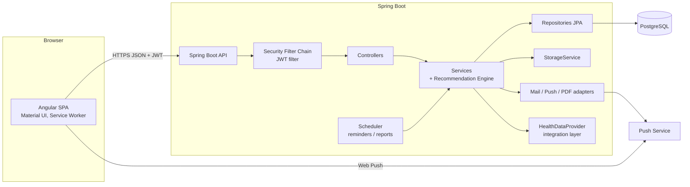

# FitTrack – Architecture & Implementation Plan

> Status: **Approved. Phases 1–2 implemented** (see README for run instructions and API reference).

---

## 1. Technology Decisions

| Layer | Choice | Notes |
|---|---|---|
| Frontend | Angular (latest stable) + Angular Material (M3 theme), NgModules (`standalone: false`) | Latest Angular needs Node ≥ 20.19 / 22.12. Installed Node 20.12.1 caps us at Angular 19 → see Open Questions |
| Charts | Chart.js 4 via `ng2-charts` | Light, theme-able for dark mode; covers line/bar/pie |
| Forms / state | Reactive Forms, RxJS services (`BehaviorSubject` stores per feature) | No NgRx – unnecessary for this scope |
| Backend | Spring Boot 3.5.x, Java 17 (Java 21 drop-in compatible) | |
| Security | Spring Security 6, stateless JWT (access) + rotating refresh token (httpOnly cookie) | |
| Persistence | Spring Data JPA / Hibernate 6, PostgreSQL 14+, **Flyway** | SQL migrations are explicit and reviewable |
| Mapping | MapStruct + Lombok | Entity ⇄ DTO, compile-time |
| API docs | springdoc-openapi (Swagger UI at `/swagger-ui.html`) | |
| Scheduling | Spring `@Scheduled` + ShedLock (safe if >1 instance) | Reminders, weekly reports |
| Push | Web Push (VAPID) + Angular Service Worker; Firebase pluggable via interface | |
| Email | Spring Mail; dev profile uses MailHog (Docker) | Password reset |
| PDF | OpenPDF | Monthly report |
| Files | `StorageService` interface → local disk impl (S3 impl later) | Profile & progress photos |
| Tests | JUnit 5, Mockito, MockMvc, **Testcontainers (PostgreSQL)**; Angular: Jasmine/Karma | |
| Deploy | Docker Compose (postgres, backend, nginx+frontend), GitHub Actions CI | |

---

## 2. System Architecture



**Request flow:** `Controller (DTO, @Valid)` → `Service (business rules, ownership, @Transactional)` → `Repository` → `Entity`.
Controllers never touch entities; services return DTOs via MapStruct mappers.

### Cross-cutting concerns
- **Standard response envelope**
  ```json
  { "success": true, "message": "Weight recorded", "data": { }, "errors": null,
    "timestamp": "2026-11-23T10:15:30Z", "path": "/api/v1/weights" }
  ```
  Paged data: `data = { content, page, size, totalElements, totalPages }`.
- **Global exception handling** (`@RestControllerAdvice`): `ResourceNotFoundException` 404, `DuplicateRecordException` 409, `BusinessRuleException` 422, validation 400 with field errors, auth 401/403, fallback 500 (no stack traces leaked).
- **Ownership**: every user-scoped query is `findByIdAndUserId(...)`. Accessing someone else's record returns **404** (no existence leak). Current user resolved from `SecurityContext` via `CurrentUserService`.
- **Auditing**: `BaseEntity` with `created_at`, `updated_at`, `created_by`, `updated_by`, `version` (optimistic locking) via JPA Auditing.
- **Time**: all instants stored as `TIMESTAMPTZ` (UTC). Each user has an IANA `time_zone` (e.g. `Asia/Kolkata`); "daily" records use a `DATE` computed in the user's zone.
- **API versioning**: `/api/v1/...`.

---

## 3. Security Design

- Registration → BCrypt (strength 12) password hash; email unique (case-insensitive index).
- Login → **access JWT (15 min, HS256, in memory on client)** + **refresh token (7 days, opaque, stored hashed in DB, httpOnly + Secure + SameSite=Strict cookie)**. Refresh rotates the token; reuse of a revoked token revokes the whole family.
- Logout → revokes refresh token, clears cookie.
- Forgot password → single-use token (random 32 bytes, stored hashed, 30-min expiry), emailed link; response is identical whether the email exists or not.
- Roles: `ROLE_USER`, `ROLE_ADMIN` (admin manages exercise, food and video catalogs). `@PreAuthorize` on admin endpoints.
- Rate limiting on `/auth/**` (Bucket4j), CORS restricted to the frontend origin, security headers, file upload type/size validation (JPEG/PNG/WebP ≤ 5 MB, re-encoded server-side to strip EXIF/GPS).
- Angular: `AuthInterceptor` (attach token, single-flight refresh on 401), `ErrorInterceptor` (snackbar), `LoadingInterceptor`; `AuthGuard`, `OnboardingGuard` (forces onboarding until assessment exists), `RoleGuard`.

---

## 4. Database Design

### 4.1 Conventions
- PK: `BIGINT GENERATED ALWAYS AS IDENTITY`.
- Every table has audit columns `created_at, updated_at, created_by, updated_by` (+ `version` on mutable tables).
- Enums stored as `VARCHAR` with `CHECK` constraints (portable, readable, easy to evolve via Flyway).
- All user-owned tables: `user_id` FK → `users(id) ON DELETE CASCADE`, plus an index starting with `user_id`.
- "One per day" tables: `UNIQUE (user_id, record_date)` → service does upsert.

### 4.2 ER Diagram

```mermaid
erDiagram
  users ||--|| user_profiles : has
  users ||--o{ user_roles : has
  roles ||--o{ user_roles : grants
  users ||--o{ refresh_tokens : has
  users ||--o{ password_reset_tokens : has
  users ||--o{ fitness_assessments : "takes (history)"
  fitness_assessments ||--o{ assessment_equipment : lists
  fitness_assessments ||--o{ assessment_limitations : declares
  equipment ||--o{ assessment_equipment : ""
  users ||--o{ fitness_goals : sets

  muscle_groups ||--o{ exercises : "primary target"
  exercises ||--o{ exercise_secondary_muscles : ""
  muscle_groups ||--o{ exercise_secondary_muscles : ""
  exercises ||--o{ exercise_equipment : needs
  equipment ||--o{ exercise_equipment : ""
  exercises ||--o{ exercise_contraindications : "avoid if"
  exercises ||--o{ exercise_alternatives : "alternative to"
  exercises ||--o{ exercise_videos : has

  users ||--o{ workout_plans : owns
  fitness_assessments ||--o{ workout_plans : "generated from"
  workout_plans ||--o{ workout_plan_days : contains
  workout_plan_days ||--o{ workout_exercises : prescribes
  exercises ||--o{ workout_exercises : ""
  users ||--o{ workout_sessions : performs
  workout_plan_days ||--o{ workout_sessions : "scheduled as"
  workout_sessions ||--o{ workout_session_exercises : logs
  exercises ||--o{ workout_session_exercises : ""
  users ||--o{ personal_records : achieves
  exercises ||--o{ personal_records : ""

  users ||--o{ daily_activity_records : logs
  users ||--o{ water_intake_entries : logs
  users ||--o{ water_daily_goals : "goal per day"
  users ||--o{ weight_records : logs
  users ||--o{ body_measurement_records : logs
  users ||--o{ sleep_records : logs
  users ||--o{ meal_records : logs
  meal_records ||--o{ meal_record_items : contains
  nutrition_foods ||--o{ meal_record_items : ""
  users ||--o{ reminders : configures
  reminders ||--o{ notifications : produces
  users ||--o{ notifications : receives
  users ||--o{ push_subscriptions : registers
  users ||--o{ progress_photos : uploads
```



### 4.3 Table Summary (key columns)

**Identity & profile**
| Table | Key columns / constraints |
|---|---|
| `users` | email (unique, citext/lower index), password_hash, enabled, email_verified, last_login_at |
| `roles`, `user_roles` | ROLE_USER / ROLE_ADMIN; PK(user_id, role_id) |
| `refresh_tokens` | token_hash (unique), family_id, expires_at, revoked_at |
| `password_reset_tokens` | token_hash (unique), expires_at, used_at |
| `user_profiles` | user_id (unique FK), full_name, date_of_birth (age is **derived**, not stored), gender `MALE/FEMALE/PREFER_NOT_TO_SAY`, height_cm, time_zone, photo_path, theme, units |

**Assessment & goals** – assessments are versioned (a new row per update; latest = `is_current = true`, partial unique index `WHERE is_current`) so recommendation history stays explainable.
| Table | Key columns |
|---|---|
| `fitness_assessments` | user_id, fitness_level, primary_goal, workout_location, available_days (smallint bitmask Mon..Sun), session_minutes, diet_preference, allergies_text, restrictions_text, injuries_notes, activity_level (SEDENTARY…VERY_ACTIVE), sleep_hours, weight_kg_at_assessment, is_current |
| `equipment` / `assessment_equipment` | master list (dumbbells, barbell, resistance band, pull-up bar, bench, machines, none) |
| `assessment_limitations` | body_area (`KNEE, LOWER_BACK, SHOULDER, WRIST, ANKLE, NECK, HIP`), severity – drives exercise filtering |
| `fitness_goals` | goal_type, target_value (e.g. target weight), start/target date, status `ACTIVE/ACHIEVED/ABANDONED` |

Current weight lives in `weight_records` only (latest row) – not duplicated in the profile. Target weight lives in `fitness_goals`.

**Exercise catalog**
| Table | Key columns |
|---|---|
| `muscle_groups` | code, name (CHEST, BACK, SHOULDERS, BICEPS, TRICEPS, LEGS, ABS, FULL_BODY, CARDIO, STRETCHING) |
| `exercises` | name (unique), slug, description, primary_muscle_group_id, difficulty, default_sets, default_reps, default_duration_sec, default_rest_sec, instructions (text), common_mistakes, safety_precautions, location `HOME/GYM/BOTH`, met_value, active |
| `exercise_secondary_muscles`, `exercise_equipment`, `exercise_contraindications`, `exercise_alternatives` | join tables |
| `exercise_videos` | exercise_id (nullable for warm-up/general), title, video_category (incl. WARM_UP), provider (`YOUTUBE`), embed_url, thumbnail_url, license_note, difficulty |

**Workouts**
| Table | Key columns |
|---|---|
| `workout_plans` | user_id, assessment_id, name, split_type, start_date, end_date, status `ACTIVE/ARCHIVED`, generated_by `ENGINE/USER`; partial unique: one ACTIVE plan per user |
| `workout_plan_days` | plan_id, day_of_week, title (“Upper Body A”), focus, is_rest_day, sort_order |
| `workout_exercises` | plan_day_id, exercise_id, sets, reps_min, reps_max, duration_sec, rest_sec, target_rpe, sort_order |
| `workout_sessions` | user_id, plan_day_id, scheduled_date, status `SCHEDULED/IN_PROGRESS/COMPLETED/SKIPPED/RESCHEDULED`, started_at, completed_at, rescheduled_to, perceived_effort (1–10), notes, calories_estimate; UNIQUE(user_id, plan_day_id, scheduled_date) |
| `workout_session_exercises` | session_id, exercise_id (may be an alternative), set_number, reps_done, weight_kg, duration_sec, completed |
| `personal_records` | user_id, exercise_id, record_type `MAX_WEIGHT/MAX_REPS/LONGEST_DURATION`, value, achieved_on, session_id |

**Tracking**
| Table | Key columns / constraints |
|---|---|
| `daily_activity_records` | user_id, record_date, steps, distance_m, active_minutes, calories_est, step_goal, source `MANUAL/HEALTH_CONNECT/APPLE_HEALTH`; UNIQUE(user_id, record_date) |
| `water_intake_entries` | user_id, record_date, amount_ml (CHECK 1–3000), logged_at |
| `water_daily_goals` | user_id, record_date, goal_ml, adjustment_reason; UNIQUE(user_id, record_date) |
| `weight_records` | user_id, record_date, weight_kg (CHECK 20–400), body_fat_pct (nullable, 2–70); UNIQUE(user_id, record_date) |
| `body_measurement_records` | user_id, record_date, waist_cm, chest_cm, arm_cm, hip_cm, thigh_cm (all nullable); UNIQUE(user_id, record_date) |
| `sleep_records` | user_id, sleep_date (date woken up), sleep_start, wake_time (TIMESTAMPTZ), duration_min (computed), quality 1–5, is_rest_day; UNIQUE(user_id, sleep_date); CHECK wake > start |

**Nutrition**
| Table | Key columns |
|---|---|
| `nutrition_foods` | name, category, diet_type `VEG/NON_VEG/VEGAN/EGG`, serving_qty, serving_unit, calories, protein_g, carbs_g, fat_g, is_system, created_by_user_id (user-custom foods) |
| `meal_records` | user_id, record_date, meal_type `BREAKFAST/LUNCH/EVENING_SNACK/DINNER`; UNIQUE(user_id, record_date, meal_type) |
| `meal_record_items` | meal_record_id, food_id, servings, + **snapshot** of kcal/macros at log time (deliberate denormalization so editing a food doesn't rewrite history) |

**Reminders & media**
| Table | Key columns |
|---|---|
| `reminders` | user_id, type `WAKE_UP/WATER/WORKOUT/WALK/MEAL/WEIGHT/SLEEP`, title, local_time, repeat_days (bitmask), interval_minutes (water), channel `PUSH/IN_APP/EMAIL`, enabled, time_zone, next_fire_at (UTC, indexed) |
| `notifications` | user_id, reminder_id (nullable), title, body, channel, status `PENDING/SENT/FAILED/READ`, sent_at, read_at |
| `push_subscriptions` | user_id, endpoint (unique), p256dh, auth, user_agent |
| `progress_photos` | user_id, taken_on, pose `FRONT/SIDE/BACK`, storage_path, notes |

### 4.4 Indexes (beyond PK/FK/unique)
- `(user_id, record_date DESC)` on every tracking table → dashboard ranges.
- `workout_sessions (user_id, scheduled_date)`, `(user_id, status)`.
- `reminders (next_fire_at) WHERE enabled` → scheduler scan.
- `exercises (primary_muscle_group_id, difficulty)`; trigram index on `exercises.name`, `nutrition_foods.name` (search).
- `notifications (user_id, status, created_at DESC)`.

---

## 5. Backend Package Structure (package-by-feature, layered inside)

```
backend/
├─ pom.xml
└─ src/main/java/com/fittrack/
   ├─ FitTrackApplication.java
   ├─ config/            # OpenApiConfig, JpaAuditingConfig, SchedulerConfig, CorsProps, AppProperties
   ├─ security/          # SecurityConfig, JwtService, JwtAuthFilter, CurrentUserService, UserPrincipal
   ├─ common/
   │  ├─ api/            # ApiResponse, PageResponse
   │  ├─ entity/         # BaseEntity, UserOwnedEntity
   │  ├─ exception/      # GlobalExceptionHandler + custom exceptions
   │  ├─ validation/     # custom validators (@ValidTimeZone, @PastOrToday…)
   │  └─ util/           # DateRange, TimeZoneUtil
   ├─ auth/              # controller, service, dto, entity (RefreshToken, PasswordResetToken), repository
   ├─ user/              # profile, photo upload, roles
   ├─ assessment/        # fitness assessment + goals
   ├─ recommendation/    # engine/, rules/, calculator/ (BMI, BMR, TDEE), dto
   ├─ exercise/          # catalog + admin CRUD
   ├─ workout/           # plans, sessions, PRs, progression
   ├─ activity/          # steps
   ├─ hydration/         # water entries, goals
   ├─ body/              # weight, measurements, progress photos
   ├─ nutrition/         # foods, meals
   ├─ sleep/
   ├─ reminder/          # reminders, scheduler job, notification dispatch
   ├─ notification/      # channels: push/, email/, inapp/
   ├─ dashboard/         # aggregation queries + insights
   ├─ report/            # weekly summary, monthly PDF, CSV export
   ├─ integration/health/# HealthDataProvider SPI + import endpoint
   └─ storage/           # StorageService + LocalStorageService
   (each feature: controller/ service/ repository/ entity/ dto/ mapper/)
src/main/resources/
   ├─ application.yml, application-dev.yml, application-prod.yml
   └─ db/migration/      # V1__identity.sql, V2__assessment.sql, ... R__seed_*.sql
```

---

## 6. Frontend Structure (NgModules, lazy-loaded features)

```
frontend/src/app/
├─ app.module.ts, app-routing.module.ts
├─ core/          # (imported once) interceptors, guards, AuthService, TokenStore, ThemeService, ApiService
├─ shared/        # MaterialModule, reusable components (stat-card, chart-card, date-range-filter,
│                 #   empty-state, confirm-dialog, disclaimer-banner), pipes (duration, kg, ml), directives
├─ layout/        # ShellComponent: sidenav (desktop) / bottom nav (mobile), toolbar, theme toggle
└─ features/
   ├─ auth/          # login, register, forgot-password, reset-password
   ├─ onboarding/    # multi-step stepper (6 steps) → assessment
   ├─ dashboard/     # KPI cards, 7 charts, insights, period filter
   ├─ workout/       # today, weekly calendar, session player, history, PRs, plan view
   ├─ activity/      # tabs: Steps | Water | Sleep
   ├─ nutrition/     # day log by meal, food search, suggestions, macro summary
   ├─ progress/      # weight, measurements, photos, reports & export
   ├─ videos/        # library, filters, player dialog (youtube-nocookie embeds)
   ├─ reminders/     # list + editor, push permission
   ├─ profile/       # profile, photo, reassessment, goals, calculators, settings
   └─ admin/         # exercise / food / video catalog management (ROLE_ADMIN)
```
Each feature: `xxx.module.ts`, `xxx-routing.module.ts`, `pages/`, `components/`, `services/`, `models/`.
Theming: Material M3 light + dark palettes via SCSS, `prefers-color-scheme` default, user override persisted in profile.

---

## 7. Recommendation Engine (rule-based, explainable)

```
RecommendationEngine
 ├─ inputs: current assessment, profile (age, height), latest weight, last 2–4 weeks of sessions & sleep
 ├─ calculators: BMI, BMR (Mifflin-St Jeor), TDEE (activity multiplier)
 ├─ rules (each implements RecommendationRule, returns item + plain-language "why")
 │   ├─ ScheduleRule        – days/week & split
 │   ├─ ExerciseSelectionRule – equipment, location, difficulty, contraindications
 │   ├─ VolumeRule          – sets/reps/rest/intensity (RPE)
 │   ├─ RecoveryRule        – rest days, sleep-based adjustments
 │   ├─ StepTargetRule, HydrationRule, NutritionRule
 └─ output: RecommendationDto { items[{category, value, explanation}], disclaimer }
```

**Key rules (safety-first):**
- **Gender is never used for workout selection.** It is used only in the BMR formula; for "prefer not to say" the midpoint constant of the two Mifflin-St Jeor equations is used, and the UI says so.
- Schedule: 2–3 days → full body; 4 → upper/lower; 5–6 → push/pull/legs (intermediate+ only). Beginners capped at 4 training days; never more than 3 consecutive training days; ≥ 1 full rest day/week always.
- Volume by goal: muscle gain 3×8–12, rest 60–90 s; weight loss / general fitness 2–3×12–15, rest 45–60 s + cardio; beginners at RPE 6–7. Age ≥ 50 or any limitation → lower-impact variants, longer warm-up.
- Exercise filtering removes anything contraindicated by declared limitations and anything needing equipment the user lacks; alternatives are suggested from `exercise_alternatives`.
- Calories: weight-loss deficit = min(500 kcal, 20 % of TDEE), **never below BMR**; muscle gain surplus ≤ 300 kcal. Implied loss rate capped ≈ 0.5 kg/week. Protein guidance 1.2–1.6 g/kg.
- Steps: start at max(current 7-day average + 1000, 5000), +1000/week up to 10 000.
- Water: ~35 ml/kg/day + 500 ml per 30 min exercise, adjustable for hot weather; capped at a sensible maximum; users with kidney/heart conditions told to follow their doctor's advice.
- Progression (double progression): all sets hit top of rep range at RPE ≤ 7 in 2 consecutive sessions → increase reps/load; ≥ 2 skips in a week, RPE ≥ 9, or average sleep < 6 h → hold or deload.
- Every output carries a disclaimer: educational guidance only, not medical advice, no guaranteed outcomes.

---

## 8. Honest Scope Notes

- **Steps:** a web browser cannot read the phone's step counter. Google Health Connect and Apple HealthKit are **native mobile APIs only**. Phase 5 delivers manual entry + a `HealthDataProvider` SPI and an authenticated `POST /api/v1/integrations/health/import` endpoint (batch daily totals with `source` tagging). A future native/Capacitor companion app would call it. The UI never claims automatic tracking.
- **Videos:** I'll ship the schema, admin CRUD and the embed player (`youtube-nocookie.com`). I cannot verify the licence of specific third-party videos, so seed data leaves `embed_url` empty or uses clearly marked placeholders. An admin adds URLs for embeddable videos that are licensed properly.
- **Food data:** about 60 common Indian foods (roti, rice, dal, paneer, eggs, chicken, oats, poha, curd, fruits, vegetables…) with approximate values from public nutrition tables, labelled "approximate".
- **Push:** Web Push works in Chrome/Edge/Firefox and in iOS Safari 16.4+ **only when the app is installed as a PWA**. In-app notifications are the fallback.
- **AI assistant:** out of scope (future phase), but there's an extension point in the UI.

---

## 9. REST API Overview (all under `/api/v1`, documented in Swagger)

| Module | Endpoints (abridged) |
|---|---|
| Auth | `POST /auth/register`, `/auth/login`, `/auth/refresh`, `/auth/logout`, `/auth/forgot-password`, `/auth/reset-password` |
| Profile | `GET/PUT /me/profile`, `POST/DELETE /me/profile/photo`, `PUT /me/password` |
| Assessment | `GET /me/assessment`, `POST /me/assessment` (new version), `GET /me/assessment/history`; `GET/POST/PUT /me/goals` |
| Recommendations | `GET /me/recommendations`, `GET /calculators/bmi|bmr|tdee` (public utility) |
| Exercises | `GET /exercises?muscle=&difficulty=&equipment=&q=`, `GET /exercises/{id}`, `GET /exercises/{id}/alternatives`; admin `POST/PUT/DELETE` |
| Workouts | `POST /me/workout-plans/generate`, `GET /me/workout-plans/active`, `GET /me/workouts/today`, `GET /me/workouts/calendar?from=&to=`, `POST /me/workouts/{sessionId}/start|complete|skip|reschedule`, `PUT /me/workouts/{sessionId}/exercises/{id}`, `GET /me/workouts/history`, `GET /me/personal-records` |
| Activity | `PUT /me/activity/{date}`, `GET /me/activity?from=&to=`, `GET /me/activity/summary?period=` |
| Water | `POST /me/water` (250/500/custom), `DELETE /me/water/{id}`, `GET /me/water/{date}`, `PUT /me/water/goal/{date}`, `GET /me/water/analytics?period=` |
| Body | `PUT /me/weights/{date}`, `GET /me/weights?from=&to=`, `PUT /me/measurements/{date}`, `GET /me/measurements/compare?from=&to=`, photos CRUD |
| Sleep | `PUT /me/sleep/{date}`, `GET /me/sleep?from=&to=`, `GET /me/recovery` |
| Nutrition | `GET /foods?q=&category=&diet=`, `POST /foods` (custom), `GET /me/meals/{date}`, `POST /me/meals/{date}/{mealType}/items`, `DELETE …/items/{id}`, `GET /me/nutrition/summary?period=`, `GET /me/nutrition/suggestions` |
| Videos | `GET /videos?category=&muscle=&difficulty=&q=`; admin CRUD |
| Reminders | `GET/POST/PUT/DELETE /me/reminders`, `PATCH /me/reminders/{id}/toggle`, `POST /me/push-subscriptions`, `GET /me/notifications`, `PATCH /me/notifications/{id}/read` |
| Dashboard | `GET /me/dashboard?period=DAY|WEEK|MONTH|YEAR` (KPIs + chart series + insights) |
| Reports | `GET /me/reports/weekly`, `GET /me/reports/monthly.pdf?month=`, `GET /me/export/records.csv` |

Using `PUT /…/{date}` for one-per-day records makes them idempotent upserts, so duplicate daily records can't happen.

---

## 10. Implementation Plan

| Phase | Deliverables |
|---|---|
| **1. Foundation** | Maven + Angular workspaces, Docker Compose (Postgres, MailHog), Spring config/profiles, BaseEntity/auditing, ApiResponse, global exception handler, OpenAPI, **all Flyway migrations for the full schema** + seed (roles, muscle groups, equipment), Angular shell (layout, theming, Material, routing, lazy modules stubbed), CI skeleton |
| **2. Auth & onboarding** | Register/login/refresh/logout, forgot/reset (MailHog), profile + photo, guards/interceptors, onboarding stepper → assessment |
| **3. Assessment & engine** | Calculators, rules, recommendation endpoint and UI with explanations, reassessment and goals; thorough unit tests for every rule |
| **4. Workouts** | Exercise catalog seed (~80 exercises) + admin CRUD, plan generation, today/calendar, session player, start/complete/skip/reschedule, history, PRs, alternatives, progression |
| **5. Water & activity (+ sleep)** | Step entry, goals, history; water quick-add, goals, analytics; sleep & recovery; health import SPI |
| **6. Body** | Weight and measurements history, comparisons, progress photos |
| **7. Dashboard** | Aggregation queries, 7 charts, period filters, insights engine, streaks, motivational messages |
| **8. Nutrition** | Food DB seed, meal logging, macro summary, diet-based suggestions |
| **9. Videos & reminders** | Video library + player, reminders CRUD, scheduler + ShedLock, Web Push + in-app notifications, weekly report, monthly PDF, CSV export |
| **10. Hardening & deploy** | Testcontainers integration suite, security review (OWASP checklist), rate limiting, Dockerfiles, nginx, prod compose, deployment README |

Each phase delivers: working backend + frontend integration, Flyway migrations, Swagger docs, validation, unit + integration tests, and a short decision log in `docs/`.

---

## 11. Decisions Taken

1. **Angular 19.2** with NgModules (`standalone: false`): it runs on the installed Node 20.12. Moving to the latest Angular needs Node ≥ 20.19/22.12; that upgrade is mechanical (`ng update`).
2. **PostgreSQL 16 in Docker Compose on port 5434.** This avoids a local PG14 on 5432 and another project's container on 5433. Any PostgreSQL works via `DB_URL`.
3. **Java 17** (installed). The code has no 17-only constraints, so it also runs on 21.
4. **Chart.js via ng2-charts** for Phase 7.
5. Components that build forms in field initializers use `inject()`, because the project compiles with `useDefineForClassFields` semantics.
